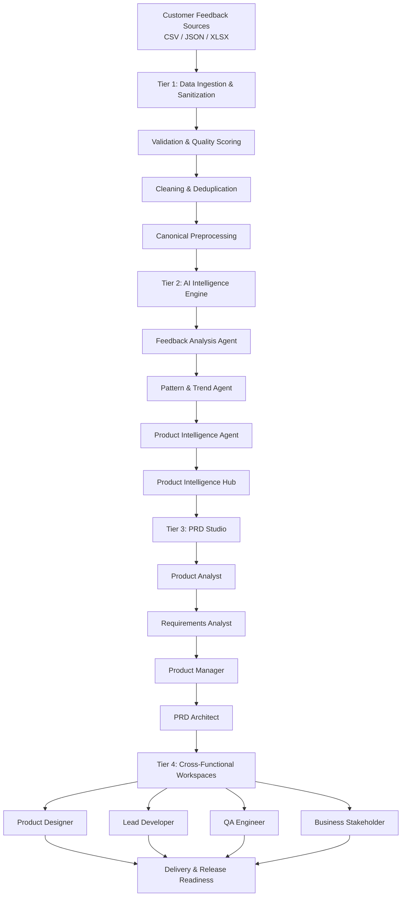

# 🚀 ProdAI — AI-Driven Product Intelligence Platform

### Transforming Customer Feedback into Actionable Product Decisions

  <strong>An AI-powered product intelligence and delivery automation platform.</strong>

  <a href="YOUR_LIVE_DEMO_URL">🌐 Live Demo</a> •
  <a href="YOUR_PORTFOLIO_URL">Portfolio</a> •
  <a href="YOUR_LINKEDIN_URL">LinkedIn</a>

  

---

## 🔒 Source Code & Security Disclaimer

> **Important:** The complete source code and internal implementation of ProdAI are maintained in a private repository and are not publicly accessible.

This public repository serves as a project showcase and documentation reference. The deployed application is provided for demonstration and recruitment evaluation purposes.

For security, intellectual property protection, and confidentiality reasons, the following remain private:

- Backend source code and internal business logic.
- AI agent implementations and orchestration workflows.
- Database schemas, configurations, and connection details.
- Environment variables, API credentials, and authentication secrets.
- Internal APIs, infrastructure configurations, and deployment workflows.

Recruiters, hiring managers, and technical evaluators are welcome to explore the live application and evaluate its functionality, interface, workflows, and observable system behaviour.

For a private technical walkthrough, architecture discussion, or additional project documentation, please reach out through my portfolio.

---

## 📌 Project Overview

**ProdAI** is an AI-driven Product Intelligence Platform designed to transform unstructured customer feedback into actionable product insights, prioritized feature opportunities, comprehensive Product Requirement Documents (PRDs), and coordinated engineering workflows.

Modern product teams receive feedback from multiple channels, including customer reviews, support tickets, surveys, and user feedback forms. Extracting meaningful insights from these sources manually is time-consuming, inconsistent, and difficult to scale.

ProdAI addresses this challenge through a structured, multi-stage intelligence pipeline that combines data validation, AI-powered analysis, deterministic prioritization, automated PRD generation, and cross-functional task coordination.

The platform connects the entire product development lifecycle:

**Customer Feedback → Data Intelligence → Product Insights → PRD Generation → Team Assignment → Implementation → Quality Assurance → Release Readiness**

Rather than functioning as a simple AI chatbot, ProdAI is designed as an integrated product operations ecosystem.

---

## 🏗️ System Architecture

ProdAI follows a four-tier architecture that separates data processing, intelligence generation, requirement engineering, and cross-functional execution.

### Tier 1 — Data Ingestion & Sanitization Engine

Processes raw customer feedback from multiple sources and prepares it for AI analysis.

- Multi-format ingestion: CSV, JSON, and XLSX.
- Customer feedback, support tickets, app reviews, and survey processing.
- Dataset and batch-level management.
- Schema validation and anomaly detection.
- Null-value imputation and data normalization.
- XSS sanitization and duplicate removal.
- Canonical token preprocessing.
- Automated data quality scoring from 0–100%.
- Gemini readiness gate and lifecycle audit.

### Tier 2 — Multi-Agent Product Intelligence Engine

Uses specialized AI agents to extract meaningful product intelligence from customer feedback.

**1. Feedback Analysis Agent**

Analyzes dataset records across ten structured dimensions:

- Sentiment
- Intent
- Product Area
- Specific Issues
- Pain Points
- Feature Requests
- Keywords
- Confidence
- Impact
- Urgency

**2. Pattern & Trend Agent**

- Semantic feedback clustering.
- Identification of recurring customer problems.
- Pattern recognition across datasets.
- Trend acceleration and deceleration analysis.
- Period-over-period trend velocity calculations.

**3. Product Intelligence Agent**

Converts extracted insights into structured product decisions using deterministic priority scoring.

The priority score follows this weighted model:

`Priority Score = (Frequency × 0.35) + (Severity × 0.25) + (Trend × 0.15) + (Sentiment × 0.15) + (Impact × 0.10)`

The resulting score ranges from 0 to 100 and helps product managers identify high-impact issues and prioritize product improvements.

### Tier 3 — AI PRD Studio & Requirements Engineering

Transforms approved product insights into structured, evidence-backed Product Requirement Documents.

The PRD generation pipeline uses four specialized agents:

| Agent | Responsibility |
|---|---|
| Product Analyst | Business rationale, problem statements, success metrics |
| Requirements Analyst | Functional and non-functional requirements |
| Product Manager | Personas, user stories, Gherkin acceptance criteria |
| PRD Architect | PRD compilation, release phases, technical constraints |

**Key capabilities:**

- Automated PRD generation.
- Epic and user story creation.
- Gherkin-based acceptance criteria.
- Functional and non-functional specifications.
- Customer evidence traceability.
- Product requirement version history.
- Review and approval workflows.
- Agent execution and revision audit trails.

### Tier 4 — Cross-Functional Team Workspaces

Connects product requirements with the teams responsible for delivering them.

| Workspace | Capabilities |
|---|---|
| Product Manager | Feedback analysis, insight approval, PRD generation, assignment and delivery readiness |
| Product Designer | UX requirements, product context, Figma submission and design sign-off |
| Lead Developer | Implementation workspace, code submissions, technical blockers and clarification requests |
| QA Lead | Test plans, test suites, test execution, defect tracking and regression verification |
| Business Stakeholder | Executive KPIs, roadmap visibility, business objectives, risk register and PRD approvals |

Each workspace provides role-specific functionality and controlled access to relevant product information.

---

## ✨ Key Features

### 1. Intelligent Data Management
- Multi-source customer feedback ingestion.
- Dataset batch management.
- Automated data quality assessment.
- Data cleaning and sanitization.
- Validation and preprocessing pipeline.

### 2. AI-Powered Product Analytics
- Multi-dimensional feedback analysis.
- Sentiment and intent classification.
- Semantic issue clustering.
- Customer pain-point identification.
- Feature request extraction.
- Trend and impact analysis.
- Deterministic feature prioritization.

### 3. Product Intelligence Dashboard
- Executive KPI overview.
- Pain-point analytics.
- Trend visualization.
- Product theme distribution.
- Sentiment analysis.
- Customer segment comparisons.
- Critical issue identification.
- Feature prioritization.

### 4. Automated PRD Generation
- Multi-agent PRD synthesis.
- Business problem identification.
- Functional requirement generation.
- User stories and acceptance criteria.
- Evidence-based requirements.
- Version management and approval workflows.

### 5. Team Collaboration & Delivery
- Role-based workspaces.
- PRD assignment management.
- Designer and developer handoffs.
- Implementation tracking.
- QA test execution.
- Defect management.
- Release readiness monitoring.

### 6. Context-Aware AI Assistant
- Natural-language conversational interface.
- Gemini-powered responses.
- Project-context-aware queries.
- Customer feedback exploration.
- Feature and requirement queries.
- Cross-functional workflow status queries.

---

## 🧠 AI Architecture & Engineering Approach

ProdAI combines AI-generated intelligence with deterministic application logic.

The objective is to avoid relying entirely on probabilistic AI outputs for critical product decisions.

| Layer | Engineering Approach |
|---|---|
| Data Validation | Rule-based validation and schema checks |
| Data Sanitization | Deterministic cleaning and normalization |
| Feedback Analysis | AI-powered structured extraction |
| Pattern Recognition | Semantic clustering and trend calculations |
| Prioritization | Weighted deterministic scoring |
| PRD Generation | Specialized multi-agent synthesis |
| Authorization | JWT authentication and granular permissions |
| Workflow Management | Application-controlled state transitions |

**Core design principle:** AI generates insights and structured recommendations, while deterministic logic and application-level controls govern validation, scoring, authorization, and workflow execution.

---

## 🛠️ Technology Stack

| Category | Technologies |
|---|---|
| Frontend | React 19, Vite |
| Styling | Tailwind CSS, Custom Design Tokens |
| UI Components | Lucide Icons |
| HTTP Communication | Axios |
| Backend | Python 3.11, FastAPI |
| API Server | Uvicorn |
| Validation | Pydantic v2 |
| AI Orchestration | CrewAI |
| Generative AI | Google Gemini API |
| Database | MongoDB Atlas |
| Database Libraries | PyMongo, Motor |
| Authentication | JWT |
| Testing | Pytest, Vitest |
| Architecture | REST APIs, Role-Based Access Control |

---

## 🔐 Security & Access Control

ProdAI implements layered security controls to protect application resources and cross-functional workspaces.

### Authentication
- JWT-based session authentication.
- Protected application routes.
- Backend request authentication.

### Role-Based Authorization
- Product Manager access controls.
- Workspace-level permissions.
- Role-specific frontend route guards.
- Backend permission enforcement.

### Permission Management

Examples of granular permissions include:

- `VIEW_WORKSPACE`
- `MANAGE_WORKSPACE`
- `GENERATE_PRD`
- `ASSIGN_PRD`

Both frontend route guards and backend authorization checks contribute to access control. Backend authorization remains the enforcement boundary.

---

## 📊 Product Development Lifecycle

ProdAI brings multiple product development activities into a unified workflow.

| Stage | Input | Output |
|---|---|---|
| Data Ingestion | Raw feedback | Structured datasets |
| Data Processing | Unstructured records | Clean, validated data |
| AI Analysis | Validated feedback | Structured insights |
| Intelligence | Extracted insights | Prioritized product issues |
| PRD Generation | Approved insights | Product requirements |
| Assignment | Approved PRDs | Role-specific work items |
| Implementation | Assigned requirements | Development submissions |
| Quality Assurance | Implementation output | Test results and defects |
| Release Readiness | QA and stakeholder reviews | Delivery readiness status |

---

## 🎯 Problem Statement & Solution

| Traditional Product Development | ProdAI Approach |
|---|---|
| Manual feedback analysis | AI-assisted structured analysis |
| Fragmented customer signals | Unified feedback ingestion |
| Subjective prioritization | Weighted deterministic scoring |
| Manual PRD preparation | Multi-agent PRD generation |
| Disconnected team handoffs | Role-based workspaces |
| Fragmented QA workflows | Integrated test and defect management |
| Limited product traceability | Customer evidence to requirement traceability |

---

## 🎥 Live Application & Project Demonstration

The deployed application is available for exploring ProdAI's implemented user-facing functionality.

**Live Demo:** [Explore ProdAI](YOUR_LIVE_DEMO_URL)

**Demonstration areas:**

- Product intelligence dashboard.
- Dataset ingestion and management.
- AI-powered feedback analysis.
- Product insights and prioritization.
- PRD Studio.
- Cross-functional workspaces.
- Context-aware AI assistant.

> Access to certain features may depend on authentication, configured demo accounts, and the availability of the deployed services.

---

## 📁 Repository Availability

The complete project implementation is maintained in a private repository.

This public-facing repository is intended to communicate the project's objectives, architecture, technical approach, and functional capabilities.

The following materials are not publicly distributed:

- Backend and frontend source code.
- Internal AI agent definitions.
- Database configurations.
- API credentials and environment variables.
- Internal deployment and infrastructure configurations.

A private technical walkthrough or additional architecture documentation can be discussed upon request.

---

## 👨‍💻 Author

### Satya Prem

**Computer Science & Engineering | Full-Stack Development | AI Engineering**

- Portfolio: [satya-prem.vercel.app](https://satya-prem.vercel.app/)
- GitHub: [SATYA-PREM](https://github.com/SATYA-PREM)
- LinkedIn: [Satya Prem](YOUR_LINKEDIN_URL)

---

## 📬 A Note to Recruiters

ProdAI demonstrates my approach to engineering an AI-driven product operations platform that extends beyond basic generative AI integration.

The project explores several important software engineering concepts:

- Multi-agent AI orchestration.
- Deterministic and AI-assisted processing pipelines.
- Data validation and quality engineering.
- Product analytics and prioritization.
- Automated requirements engineering.
- REST API architecture.
- Role-based access control.
- Cross-functional workflow automation.
- Full-stack application development.

The live deployment is available for functional evaluation. For a deeper technical discussion covering architectural decisions, implementation approaches, AI orchestration, and system design, please connect with me through my portfolio.

---

  <strong>ProdAI — From Customer Signals to Product Delivery.</strong>

  Built with engineering, AI, and product thinking.

